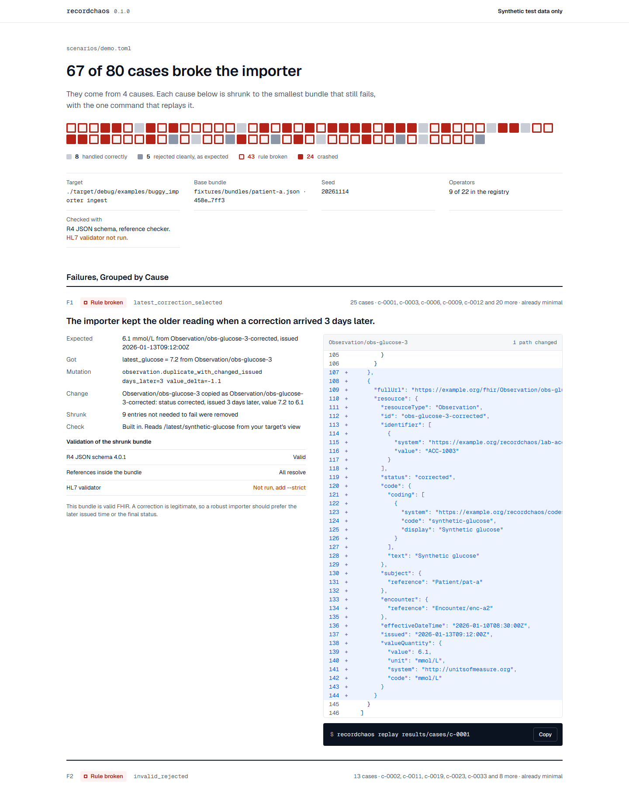

> **Status: pre-release.** Version 0.1.0 is not published yet; until it is, install from source. The results below were measured on one development machine on 2026-11-15; they are not a release benchmark.

# recordchaos

recordchaos breaks synthetic HL7® FHIR® R4 patient records on purpose, to test whether your importer copes with them.

You give it a clean synthetic FHIR R4 bundle and a short scenario file. It makes many broken or awkward copies of that bundle (a lab result corrected three days later, a unit written differently, a link to a record that does not exist, the entries in a different order), sends each copy to your importer, and checks what your importer did with it. Every failure is shrunk to the smallest bundle that still fails, and comes with one command that replays it.

It is deterministic and privacy-first: synthetic data only, no network except the target you declare (with `--strict`, the HL7 validator also downloads FHIR packages on its first run; no patient data is sent), no telemetry, and no language model anywhere.

## A Walkthrough

A developer runs the walkthrough scenario against the example importer that ships with recordchaos, which has four seeded bugs. The terminal prints one line per stage, then each cause of failure with its finding sentence and a replay command, then the verdict. This is the real output of one run (release build, Windows 11 Pro), starting with the command line that recordchaos echoes:

```text
$ recordchaos run scenarios/late-correction.toml --target examples/targets/buggy-importer.toml
recordchaos 0.1.0 · seed 49302 · base fixtures/bundles/patient-a.json (458e…7ff3)

generate  25 cases from 4 operators                                             0.04 s
validate  schema 25/25 · references 13/25 · strict not run (add --strict)
baseline  ./target/debug/examples/buggy_importer ingest · view captured         0.10 s
run       25 cases                                                              1.38 s
          ✓ 1 handled     0 rejected cleanly   ✗ 17 rule broken   ✗ 7 crashed
shrink    24 failures, 55 replays                                               3.38 s

✗ F1  invalid_rejected             9 cases   already minimal
      The importer accepted the bundle without rejecting or flagging it when a result reference pointed at a resource that is not in the bundle.
      recordchaos replay results/cases/c-0004
✗ F2  latest_correction_selected   7 cases   already minimal
      The importer kept the older reading when a correction arrived 3 days later.
      recordchaos replay results/cases/c-0017
✗ F3  no_crash                     7 cases   already minimal
      The importer exited with code 101 when the Patient reference used a urn:uuid.
      recordchaos replay results/cases/c-0010
✗ F4  same_as_base                 1 case    1 mutation (from 2)
      The importer reported a different latest_glucose when the entries were in a different order.
      recordchaos replay results/cases/c-0021

24 of 25 cases broke the importer.
report    results/report.html   junit results/junit.xml   exit 1
```

The second cause reads: "The importer kept the older reading when a correction arrived 3 days later." Below it in `results/report.html`: the expected value (6.1 mmol/L from the corrected Observation), the value the importer kept (7.2 mmol/L), the one mutation that triggers it, and `recordchaos replay results/cases/c-0017`. The developer fixes the importer and runs the replay again; against the fixed example importer it prints `c-0017 passes now`. They add the scenario to CI, where the run fails the build if anything breaks again.

The top of `results/report.html` from the demo run (`scenarios/demo.toml` against the same example importer). The report follows the system's light or dark theme.

<picture>
  <source media="(prefers-color-scheme: dark)" srcset="docs/images/report-dark.png">
  
</picture>

## Who It Is For

Developers who write code that reads FHIR: importers, EHR integrations, patient timeline builders, and AI apps that take FHIR as input.

## Install

Nothing is published yet. Once released:

```bash
# Prebuilt binary (shell installer; a PowerShell installer is also provided)
curl --proto '=https' --tlsv1.2 -LsSf https://github.com/logitsolutionsai/recordchaos/releases/latest/download/recordchaos-installer.sh | sh

# From source
cargo install --git https://github.com/logitsolutionsai/recordchaos recordchaos

# Python package and pytest plugin
pip install recordchaos
```

Before release, build the Python package from a clone of the repository (needs Rust):

```bash
pip install ./python
```

## Quick Start

From a clone of this repository, try it on the bundled example importer, which has four seeded bugs:

```bash
cargo build --example buggy_importer      # the example importer the targets below point at
recordchaos operators list                # the 22 operators
recordchaos validate fixtures/bundles/patient-a.json
recordchaos run scenarios/demo.toml --target examples/targets/buggy-importer.toml
recordchaos replay results/cases/c-0001
recordchaos run scenarios/demo.toml --target examples/targets/fixed-importer.toml --out results/fixed
```

The demo run against the buggy importer exits 1 with four findings; on the measurement machine it took 8.9 seconds (see Measured Results). The run against the fixed importer exits 0. Without an installed binary, use `cargo run --release --` in place of `recordchaos`.

To start on your own importer, `recordchaos init` writes a starter scenario and target file into the current folder. Point the scenario's `base` at your synthetic bundle and the target's commands at your importer.

## How It Works

```text
scenario.toml ─┐
base bundle ───┼─> generate cases ─> validate (3 layers) ─> run on target ─> check oracles ─> shrink failures ─> report
target.toml ───┘      (seeded)          per case                                                  (ddmin)       html, json, junit
```

1. **Load** the base bundle and build its reference graph. A base bundle that fails the schema or has a dangling reference is refused: the baseline must be clean.
2. **Run the base bundle on the target first** and keep the view it reports as the baseline.
3. **Generate cases** with a seeded random generator (ChaCha8). Every change is recorded as a JSON Patch.
4. **Validate** each case on every enabled layer. An operator's label is never trusted: if a case meant to be invalid comes out valid, it is reported.
5. **Run** each case on the target: reset, ingest, observe.
6. **Check** the oracles against the observed view.
7. **Shrink** each failure: first the list of mutations, then the bundle's entries, keeping the failure's fingerprint.
8. **Report** to the terminal, `results/report.html`, `results/results.json` and `results/junit.xml`.

The same seed and inputs give byte-identical `bundle.json`, `patch.json` and `results.json`.

## Scenario and Target Files

```toml
# scenarios/late-correction.toml
fhir_version = "4.0.1"
base = "../fixtures/bundles/patient-a.json"
seed = 49302
cases = 25
max_mutations_per_case = 3

[[operator]]
id = "observation.duplicate_with_changed_issued"
select = { resource_type = "Observation", code = "synthetic-glucose" }
args = { days_later = 3 }
weight = 3

[[operator]]
id = "reference.to_urn_uuid"
select = { resource_type = "Patient" }
```

```toml
# examples/targets/buggy-importer.toml
kind = "command"
reset   = ["./target/debug/examples/buggy_importer", "reset"]
ingest  = ["./target/debug/examples/buggy_importer", "ingest"]   # bundle on stdin
observe = ["./target/debug/examples/buggy_importer", "observe"]  # view JSON on stdout
timeout_ms = 5000

[accept]
rejected_exit_codes = [2]

[view]
latest_glucose = "/latest/synthetic-glucose"
patient_count  = "/patients/count"
```

A target can be any command (run without a shell), a local FHIR server over HTTP, or Python functions in-process through the pytest plugin. See [docs/targets.md](docs/targets.md).

## The 22 Operators

| # | Operator | Intended | Caught by |
|---|---|---|---|
| 1 | `observation.duplicate_with_changed_issued` | Valid, edge case | none |
| 2 | `observation.correction_sequence` | Valid, edge case | none |
| 3 | `identifier.duplicate_business_identifier` | Valid, edge case | none |
| 4 | `medication.conflicting_active_requests` | Valid, edge case | none |
| 5 | `time.backdate_effective` | Valid, edge case | none |
| 6 | `time.future_effective` | Valid, edge case | none |
| 7 | `time.date_only_precision` | Valid, edge case | none |
| 8 | `time.timezone_offset_shift` | Valid, edge case | none |
| 9 | `time.period_end_before_start` | Invalid | strict only (per-1) |
| 10 | `quantity.equivalent_unit` | Valid, edge case | none |
| 11 | `quantity.remove_unit_code` | Valid, edge case | none |
| 12 | `observation.data_absent_reason` | Valid, edge case | none |
| 13 | `observation.remove_code` | Invalid | schema |
| 14 | `observation.remove_status` | Invalid | strict only (1..1) |
| 15 | `reference.to_urn_uuid` | Valid, edge case | none |
| 16 | `reference.to_absolute_url` | Valid, edge case | none |
| 17 | `reference.dangling_target` | Invalid | references |
| 18 | `reference.cross_patient` | Invalid | references |
| 19 | `bundle.reorder_entries` | Valid, no change in meaning | none |
| 20 | `bundle.duplicate_full_url` | Invalid | references, strict (bdl-7) |
| 21 | `resource.unexpected_type` | Valid, edge case | none |
| 22 | `text.unicode_narrative` | Valid, edge case | none |

Each operator's eligibility rules, the paths it may change, an example before and after, and its arguments are in [docs/operators.md](docs/operators.md), generated from the same registry as `recordchaos operators list`.

## Validation Layers

| Layer | Default | Checks |
|---|---|---|
| `schema` | on | The official R4 JSON schema, bundled unmodified, offline |
| `references` | on | Every reference resolves inside the bundle; no duplicate `fullUrl`; no reference that links two patients' records |
| `strict` | off, `--strict` | The HL7 Java validator (`validator_cli.jar`), R4, terminology off |

The strict layer needs Java 17 (on `PATH` or in `JAVA_HOME`) and the validator jar, which you download yourself (`scripts/fetch-validator.sh`). recordchaos never bundles it. It runs HL7's validator as:

```text
java -Dfile.encoding=UTF-8 -jar validator_cli.jar <folder of case bundles> -version 4.0.1 -tx n/a -allow-example-urls true -output <result.json>
```

- `-allow-example-urls true` is needed because the synthetic fixtures use `example.org` code and identifier systems, as recordchaos requires for synthetic data. Without the flag, the validator reports every one of them as an error, so even the clean base bundle would fail.
- `-tx n/a` turns the terminology server off, and `-Dfile.encoding=UTF-8` keeps non-ASCII narrative intact on Windows.
- All of a run's cases go to one validator run, which loads the FHIR packages once and returns one result per case. The bundles that shrinking changed take one more run. A case the validator gives no result for counts as not checked.
- The validator's first run downloads FHIR packages into `~/.fhir/packages`, which needs network access. On the measurement machine that took 14 minutes, so run it once by hand to fill the cache.
- Measured on 2026-11-15 on the same Windows 11 Pro machine (release build, warm package cache, other builds running, so the times varied a lot): the 80-case demo with `--strict` took 57.3 s, of which validation took 26.2 s. On a 10-case version of the demo, the earlier design that started the validator once per bundle took 1,167.6 s, and the current one took 122.3 s.

Without `--strict`, the report says "HL7 validator not run" in the run summary and in every case's validation table, and those cases count as not checked, never as passing. With `--strict`, a missing Java or jar stops the run with exit 3 and a one-line fix, and a validator run that fails or times out marks each of its cases not checked.

## Checks

Built in: `no_crash`, `invalid_rejected`, `same_as_base`, `latest_correction_selected` and `no_cross_patient_merge`. You can add your own in the target file with a small, fixed set of comparisons: `equals`, `not_equals`, `exists`, `absent`, `count_equals` and `same_as_base`. There is no expression language and no code execution.

## pytest Plugin

```python
import recordchaos

@recordchaos.cases("scenarios/late-correction.toml")
def test_importer(case):
    store = MyImporter()
    try:
        for step in case.steps:          # one bundle, or two for a correction sequence
            store.load(step)             # dict
    except Rejected:                     # your importer refused the bundle on purpose
        case.check(view={}, rejected=True)
        return
    case.check(view={
        "latest_glucose": store.latest("synthetic-glucose"),
        "patient_count": store.patient_count(),
    })
```

Each case becomes one pytest item, named by case id and operators. `case.check` runs the same oracles as the command-line tool and fails with the finding sentence. Any other exception from your importer counts as a crash, fingerprinted by its type and the line that raised it. The scenario path is relative to the folder you run pytest from.

- `pytest --recordchaos-shrink` shrinks a failing case to the fewest mutations that still fail.
- `pytest --recordchaos-report results/` writes the same report.html, results.json and junit.xml.
- `pytest --recordchaos-confirm-synthetic` continues when a base bundle has values that look like real identifiers. Use synthetic data only.

## Measured Results

Measured, never estimated. Every value below comes from real runs on 2026-11-15 on Windows 11 Pro with a release build (Rust 1.100, MSVC), with no other builds running. The run is `scenarios/demo.toml` (seed 20261114, 80 cases, 9 operators) against the example importer, without `--strict`.

| Result | Expected | Measured |
|---|---|---|
| Seeded bugs found in the example importer | 4 of 4 | 4 of 4: `latest_correction_selected`, `invalid_rejected`, `no_crash` and `same_as_base` |
| False alarms against the fixed importer | 0 | 0 of 80 cases |
| Each seeded bug shrunk to one mutation | 4 of 4 | 4 of 4 (one case per cause is shrunk, the one with the fewest mutations; in this run each already had one) |
| Cases per second (command target) | none set | 17.6 (80 cases in 4.5 s; each case starts the importer at least 3 times); the whole run took 8.9 s |
| Shrinking | none set | 56 replays in 2.8 s for 67 failing cases in 4 causes |
| Schema-valid share of valid-edge cases | 100 percent | 100 percent (54 of 54) |
| Expected-invalid agreement per layer | per layer | schema 5 of 5 (`observation.remove_code`), references 21 of 21 (`reference.dangling_target`), strict not run in this measurement. Checked by hand with validator 7.0.6: `observation.remove_status` and `time.period_end_before_start` are caught by the strict layer only |
| pytest plugin against `examples/python-importer` | 4 of 4 | 4 of 4 findings, 67 of 80 cases failed, 0 against the fixed importer |

Generating cases from a large base bundle was measured separately, on the same machine with other builds running: from a synthetic bundle of 4,900 resources, 20 demo cases took 9.35 s (about 0.47 s per case, including validation and writing each 3.9 MB case to disk), and one case that breaks the schema took 0.71 s.

## What It Does Not Check

- **Invariants and required fields.** The R4 JSON schema does not require `Observation.status` or check that a period starts before it ends. Only the HL7 validator does; run with `--strict` to include it.
- **Terminology.** Codes are synthetic and are never checked against a terminology server.
- **Clinical sense.** A passing run says the importer copes with these shapes of data. It says nothing about clinical correctness.
- **De-identification.** `recordchaos run` warns when a base bundle holds values that look like real identifiers (SSN-shaped numbers, phone numbers, emails outside `example.org`) and asks for `--i-confirm-synthetic`. This heuristic does not prove that a bundle is de-identified. Use synthetic data only.

Not in v1: FHIR R5 or STU3, terminology checks, Bulk Data `$export` input and NDJSON input.

## Exit Codes

`0` no failures, `1` failures found, `2` invalid input or config, `3` target or validator unavailable, `4` internal error.

## Compatibility

- Tested against: the bundled example importer (command target) and the Python example importer (pytest plugin). HTTP targets are written for local FHIR servers such as HAPI FHIR, but no HTTP server has been tested yet.
- Synthea bundles have not been tested as base bundles. A base bundle must pass the schema and reference checks and stay within the limits (10 MB, 5,000 resources).
- Building from source needs Rust 1.85 or later, and the pytest plugin needs Python 3.10 or later. These are the declared minimums; so far only Rust 1.100 and Python 3.15 have been tested.

## Logit Solutions AI

recordchaos is built by Logit Solutions AI. If you are building AI or data tools on top of patient records, read the [AI in Medical Practices guide](https://logitsolutions.ai/guides/ai-in-medical-practices/), and for importers and integrations, the [AI Integration and Automation guide](https://logitsolutions.ai/guides/ai-integration-and-automation/). To talk about your own system, book a [free consultation](https://logitsolutions.ai/contact/).

## Licence

Apache-2.0. See [LICENSE](LICENSE) and [NOTICE](NOTICE). The bundled R4 JSON schema is from the FHIR specification, licensed CC0, and ships unmodified. Geist and Geist Mono are embedded in the report under the SIL Open Font License. Release archives will include `THIRD-PARTY-LICENSES.html`, which cargo-about writes from the crates compiled into the binary (see `about.toml`); it accepts only the licences that `deny.toml` allows.

HL7, FHIR and the FHIR [FLAME DESIGN] are the registered trademarks of Health Level Seven International and their use does not constitute endorsement by HL7.
